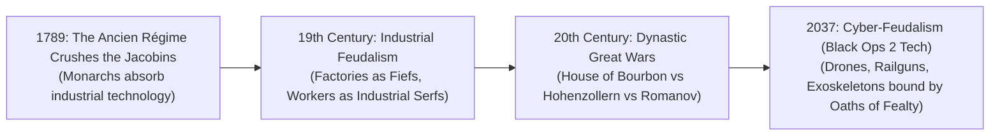
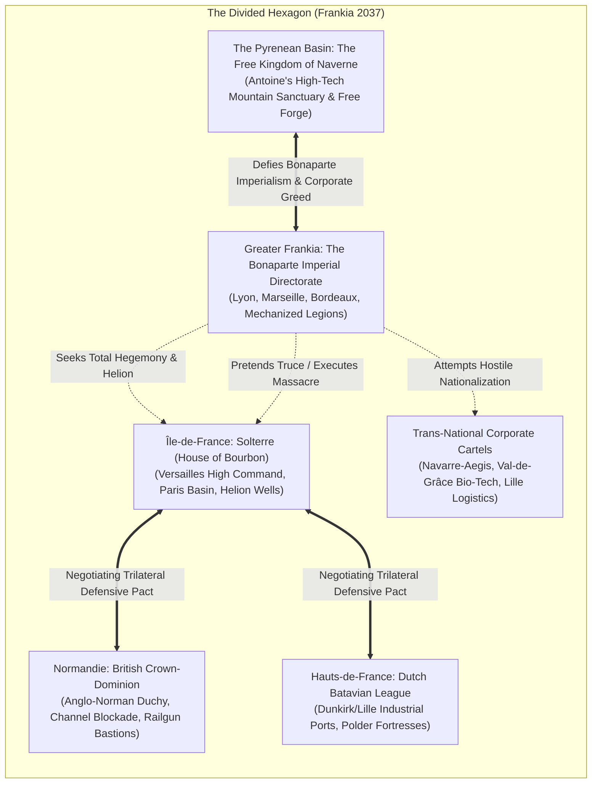
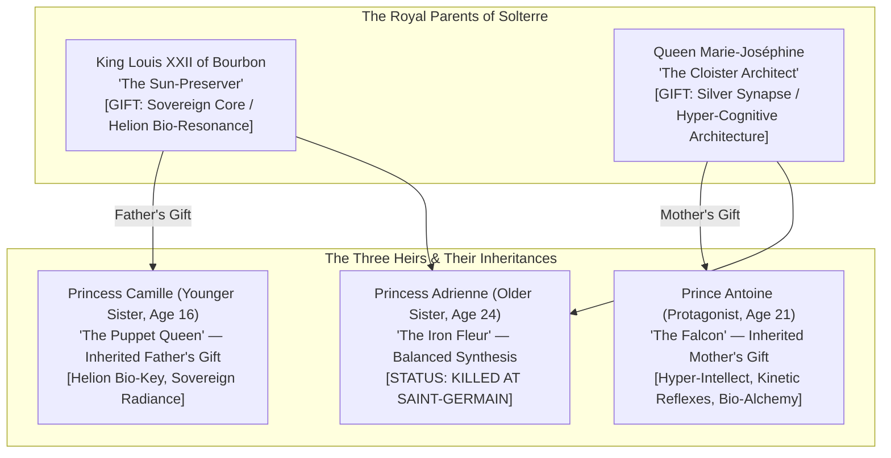
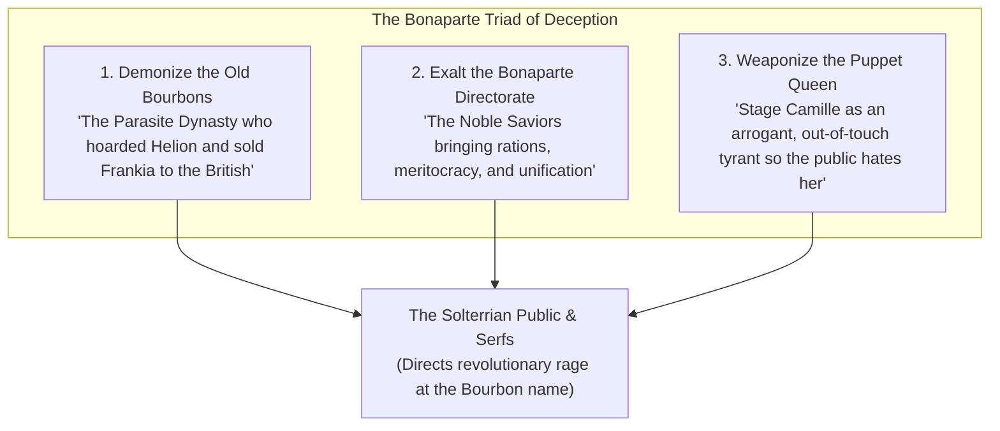
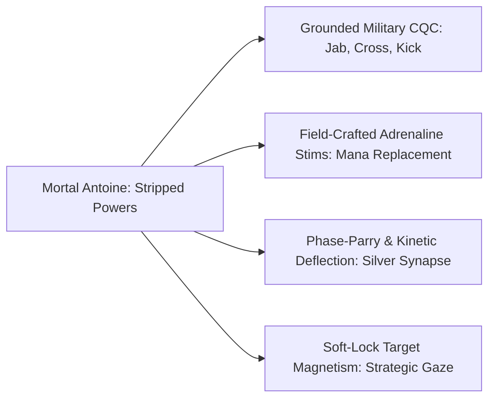

# UPRISING: THE BLOOD SACRAMENT (2037)
## Official Worldbuilding, Narrative, & Design Bible
**Alternative History Premise**: *What if Feudalism continuously survived until 2037?*

---

### Document Overview & Metadata

* **Project Title**: *Uprising: The Blood Sacrament*
* **Historical Timeline**: Unbroken Feudal Continuum (1789 – 2037)
* **Core Genre**: Dark Science-Fantasy / Cyber-Feudal Action RPG / Tactical Near-Future Brawler
* **Thematic Pillars**: 
  * Biological Determinism vs. Bodily Autonomy
  * The Weaponization of Propaganda & Scapegoating
  * High-Tech Asymmetrical Insurgency (*Black Ops 2* meets *Arknights*)
  * Royal Tragedy & Redemption (*FF Versus XIII / XV / XVI / Bloodborne*)
  * Historical Resonance: *Antoine de Bourbon & The Kingdom of Navarre*, *Abd al-Rahman I (The Falcon of Umayyad)*
* **Geopolitical Focus**: The Divided Hexagon of Frankia (France)
* **Protagonist**: Prince Antoine of Bourbon ("The Falcon of Solterre" / "King of Naverne")

---

## 1. The Core Alternate-History Premise: Unbroken Feudalism (1789 – 2037)

> **"What if the French Revolution of 1789 was crushed, and Feudalism never died—evolving seamlessly through the Industrial, Digital, and Cybernetic Eras into the year 2037?"**

In this timeline, republics, democratic nation-states, and egalitarian constitutions were stillborn anomalies. Rather than being toppled by the merchant class or peasant uprisings, the European royal dynasties and feudal institutions adapted to, monopolized, and weaponized every successive wave of technological innovation:



### The Institutional Architecture of Cyber-Feudalism

1. **Fiefdoms as Mega-Enclaves**: Land, automated manufacturing complexes, server farms, and energy grids are hereditary dynastic estates. There is no public commons; every square kilometer is owned by a crowned house, a titled lord, or a chartered corporate guild.
2. **The Trans-National Corporate Syndicates**: Corporations do not exist as public democratic companies; they are **Chartered Sovereign High Cartels** granted royal monopolies. They operate private armies (PMCs), extraterritorial extraction basins, and research foundries.
3. **The New Serfdom (Data & Flesh Serfs)**: The common populace are legally bonded to dynastic estates or corporate cartels through hereditary employment charters. A serf’s biometric data, genetic code, neural interfaces, and children are legal property of their overlord. In exchange, the lord provides armed robotic protection against lawless banditry, radiation storms, and foreign raids.
4. **The Neo-Chivalric Military Order**: Armies are not conscripted citizen-soldiers; they are hereditary **Knightly Retinues**, corporate PMCs, and private house legions. Elite knights wear powered exoskeletons emblazoned with family crests, wield smart-blades alongside suppressed rail-carbines, and deploy autonomous drone swarms bound to their neural helmets.
5. **Fealty via Cryptographic Smart-Contracts**: Oaths of fealty (*Homage and Fealty*) are digitally encoded into neural implants. Treason or desertion is not merely a crime; it automatically triggers remote bio-paralysis or cybernetic neuro-termination.

---

## 2. Geopolitical Theater: The Divided Realm of Frankia (2037)

The territory of former France—historically called **Frankia**—is a fractured, heavily militarized continent on the brink of total war:



### The Sovereign Factions & Corporate Cartels

| Power / Syndicate | Territory | Government & Ideology | Military & Aesthetic Profile |
| :--- | :--- | :--- | :--- |
| **Solterre** *(House of Bourbon)* | **Île-de-France** (Paris, Versailles, Fontainebleau) | **Sovereign Neo-Bourbon Monarchy**. Renamed *Solterre* ("The Land of the Sun") by the Bourbons to immortalize King Louis XIV (*The Sun King*). Cultivates high-tech baroque art, solar dignity, and dynastic survival. | *Aesthetic*: Baroque Neoclassicism meets *Call of Duty: Black Ops 2* military precision. Gilded ballistic capes, golden-anodized exoskeleton suits, solar-shielded drone sentries, laser-guided musketeers. |
| **The Bonaparte Empire** *(House of Bonaparte)* | **Greater Frankia** (The Centre, West, South, and East: Lyon, Marseille, Bordeaux) | **Militaristic Expansionist Empire**. An ambitious military dynasty that seized provincial industrial centers during the 20th-century Dynastic Wars. Aggressive, meritocratic-feudal, determined to subjugate all Frankia. | *Aesthetic*: Brutalist industrial militarism. Matte-black VTOL gunships, autonomous walker tanks, mass-manufactured cyber-infantry, orbital reconnaissance satellite feeds. |
| **The Free Kingdom of Naverne** *(Founded by Antoine)* | **The Pyrenean Frontier** (Pau, Biarritz, Mountain Fortresses) | **Revolutionary Merit-Monarchy**. A sovereign high-tech sanctuary born from a corporate slave mutiny. Commoners are sovereign citizens, bonded labor is abolished, and military technology is democratized. | *Aesthetic*: Rugged tactical cyberpunk mixed with Basque-Navarrese royal heraldry. Weathered black-and-gold trench cloaks, re-engineered corporate combat chassis, customized rail-carbines, subterranean geothermal forges. |
| **Navarre-Aegis Heavy Industries & Biotech** | **Pyrenean & Aquitaine Extraterritorial Zones** | **Trans-National Corporate Mega-Cartel**. Holds monopolies over lithium-Helion refinement, advanced cybernetics, and PMC security forces. Relies on millions of debt-bonded factory serfs. | *Aesthetic*: Corporate PMC militarism. Sleek matte-white exoskeleton armor, holographic corporate logos, automated drone security swarms, biometric compliance collars. |
| **British Dominion of Normandie** | **Normandie** (Rouen, Le Havre, Caen, Cherbourg) | **Anglo-Norman Feudal March**. Re-annexed by the British Crown under ancient medieval treaty claims. Acts as an offshore fortress guarding the Channel. | *Aesthetic*: Cold, wet, utilitarian tactical. Heavy reactive-armor mechs, gas-masked trench stormtroopers, offshore automated railgun destroyers. |
| **The Dutch Batavian League** | **Hauts-de-France** (Lille, Calais, Dunkirk) | **Mercantile Oligarchic League**. Controls northern continental shipping, automated refinery networks, and advanced hydrological defenses. | *Aesthetic*: Utilitarian corporate PMC. High-speed amphibious hover-tanks, digitized supply-chain networks, precision merc corps. |

---

## 3. The Fuel of War: **Helion-Chrism**

Beneath the limestone catacombs of Paris and Île-de-France lies the continent's most coveted prize: **Helion-Chrism** (often called *"Liquid Sol"* or *"The Imperial Sanguis"*).

* **Industrial Utility**: A room-temperature bio-synthetic isotope discovered deep in the Paris Basin aquifer. It functions as an ultra-dense quantum battery capable of powering entire metropolitan defense shields, orbital railguns, and drone armies for months without recharging.
* **Biological Utility**: When refined into clinical serums, Helion-Chrism acts as a **neural stabilizer**. It allows human biology to interface with high-tier cybernetic neural overclocks and military wetware without suffering fatal neurological burnout (*The Ash-Rot*).
* **The Strategic Crisis**: The Bonapartes' aggressive industrial militarization has drained their southern synthetic reserves. Their mechanized armor divisions and augmented shock-troops are degrading. **To survive and dominate Europe, the Bonapartes must conquer Solterre and seize the Helion wells.**
* **The Diplomatic Gamble**: Protected by a fragile peace truce, the Bourbons were secretly negotiating the **Trilateral Iron Entente** with **Britain (Normandie)** and the **Dutch (Hauts-de-France)**—trading Helion energy shipments for a mutual defense pact to encircle and deter the Bonaparte Empire.

---

## 4. The Royal Lineage of House Bourbon: Parents & Inherited Bloodlines



### The Royal Parents

1. **The Father: King Louis XXII of Bourbon ("The Sun-Preserver")**:
   * **Legacy**: Reigned over Solterre with stoic aristocratic dignity, attempting to safeguard the realm through geopolitical balancing.
   * **Bloodline Gift — "The Sovereign Core" (Helion Bio-Resonance)**: The direct male Bourbon lineage possesses cells that act as organic transducers for **Helion-Chrism**. Their biology absorbs, filters, and channels raw subterranean energy without cellular degradation.
   * **Inherited by Princess Camille**: Camille inherited her father's pure Helion-resonance genome. **This is why the Bonapartes kept her alive:** The deepest extraction vaults beneath Paris are biometrically and epigenetically keyed to King Louis’s direct genetic resonance. Without Camille, extracting the high-pressure Helion wells triggers a cataclysmic geothermal eruption.
2. **The Mother: Queen Marie-Joséphine of Bourbon-Savoy**:
   * **Lineage**: Descended from an ancient medical-intellectual dynasty of northern Italy and the Alps, celebrated for pioneering pre-collapse neural engineering and tactical diplomacy.
   * **Bloodline Gift — "The Silver Synapse" (Hyper-Cognitive Neural Architecture)**: A hyper-dense cerebral cortex granting near-instantaneous tactical calculation, predictive situational awareness, photographic muscle memory, and intuitive biochemistry.
   * **Inherited by Prince Antoine ("The Falcon")**: **This is why Antoine remains terrifying even after his powers were stripped:** The Bonaparte "Lethe-Cutter" burned away his cybernetic nanites and Helion overclocks, but it *could not alter his mother's organic brain architecture*. His cold tactical intellect, surgical muscle memory, and psychological resilience as "The Doctor" are biological gifts from Queen Marie-Joséphine that no chemical weapon could ever erase.

### The Three Siblings & Their Fates

1. **Princess Adrienne (Older Sister, Age 24 — The Fallen Crown Princess)**:
   * **Role**: The legitimate heir apparent to the throne of Solterre. A brilliant diplomat and decorated commander of the Royal Musketeer Exoskeleton Guard who synthesized both parents' gifts.
   * **The Sacrifice**: At the Banquet of Saint-Germain, recognizing the ambush, Adrienne ignited her ceremonial smart-blade and held the blast-doors against Bonaparte cyber-commandos, sacrificing her life so Antoine could attempt to evacuate Camille. Her death created an instantaneous, catastrophic power vacuum across Île-de-France.
2. **Prince Antoine (Protagonist, Age 21 — The Falcon of Solterre / King of Naverne)**:
   * **Role**: The middle child, master strategist, and physician.
   * **The Trauma**: Witnessed Adrienne cut down while failing to prevent Bonaparte commandos from tearing Camille from his arms. Injected with the Lethe-Cutter, stripped of his augments, and flushed down the Seine, he carries crushing survivor's guilt.
3. **Princess Camille (Younger Sister, Age 16 — The Puppet Queen)**:
   * **Role**: The gentle, sheltered sixteen-year-old princess.
   * **The Captivity**: Crowned as **Queen Camille I of Solterre** under a Bonaparte military "protectorate." Wears a gilded neural compliance choker, serving as both the biological key to the Helion wells and the public scapegoat for the occupation.

---

## 5. The Bonaparte Propaganda Machine: The Engineered Tyrant



1. **Demonizing the Old Bourbons ("The Parasite Dynasty")**:
   - The state-controlled HoloNet circulates decontextualized diplomatic leaks framing the late King and Princess Adrienne as traitors who conspired to sell Frankia’s soil to British railguns in Normandie and Dutch merchants in Lille.
   - Endless media coverage contrasts Versailles' gilded Helion vaults with starving marshland children: *"The Bourbons starved you so their blood could glow."*
2. **The Bonapartes as "The Liberators of the Flesh"**:
   - Military supply convoys distribute synthetic flour and bio-clean water branded with the Golden Imperial Eagle across Parisian slums.
   - The Directorate brands their violent coup as a "Humanitarian Stabilization Operation" that finally ended Bourbon tyranny.
3. **Staging Queen Camille as "The Ruler Who Should Never Be"**:
   - Camille is forced onto live broadcasts dressed in gaudy, diamond-encrusted finery, wearing a compliance choker that forces her to read decrees raising bread taxes and ordering the execution of "dissidents."
   - When public anger peaks, a Bonaparte military governor dramatically steps in on live holocast to **"veto"** or **"soften"** her cruel decree on behalf of the people.
   - **The Trap**: The public idolizes the Bonapartes as their protectors, while channeling 100% of their hatred directly onto young Camille and the Bourbon bloodline.

---

## 6. Antoine's Journey: From Severed Scion to King of Naverne

```
[Character Design: Prince Antoine of Bourbon]
- Identity: Crown Prince of Solterre, Scion of the Sun King, King of Naverne ("The Falcon").
- Silhouette: Weathered charcoal military trench coat with faded gold-thread fleur-de-lis lining.
- Mask/Face: Ballistic cowl/half-mask concealing royal aristocratic features; a Bonaparte prisoner-brand seared into his jawline.
- Gear: Field surgeon bandolier, carbon-fiber knuckles, modular auto-syringes, silenced PDW holster.
- Status: Royal augments and Helion-Chrism purged. Reduced to mortal baseline.
```

```mermaid
sequenceDiagram
    autonumber
    actor B as Bonaparte Directorate
    actor S as Solterre (Massacred)
    actor A as Prince Antoine (The Falcon)
    actor C as Corporate Cartel (Navarre-Aegis)
    actor N as The Free Kingdom of Naverne

    Note over B,S: The Massacre of Saint-Germain
    B->>A: Strips Powers with Lethe-Cutter
    A->>A: Escapes via the Seine River (Presumed Dead)
    Note over A,C: The Corporate Contractor Phase (Arknights / Doctor)
    A->>C: Assumes alias 'Doc Vane'; works as PMC trauma surgeon
    A->>C: Saves mercenary lives; builds underground network
    Note over B,C: Bonaparte Attempts Hostile Corporate Takeover
    B->>C: Bonaparte commissars arrive to nationalize factories
    A->>C: Leads mutiny of debt-bonded serfs & mercenary units
    A->>N: Seizes Pyrenean fortresses; Proclaims KINGDOM OF NAVERNE
    Note over N,B: The Counter-Offensive
    N->>B: Marches north with high-tech army to save Camille & free Solterre
```

### Phase I: The Escape Across the Seine (*Abd al-Rahman I Paradigm*)
* At the Saint-Germain banquet, after watching Adrienne fall and Camille captured, Antoine was injected with **"The Lethe-Cutter"**—an irreversible neuro-chemical purge that scorched his nanites, burned his cyber-pathways, and drained his royal Helion-Chrism.
* Bound and bleeding, Antoine hurled himself through a stained-glass window into the freezing, industrial runoff of the Seine River. Drones swept the waters with thermal lasers, killing his surviving cousin beside him. Drifting beneath a burning fuel barge, Antoine survived against all odds, washing ashore miles away in the contested marshlands.

### Phase II: The Corporate Contractor Phase (*Arknights Doctor Mode*)
* Antoine travels south under a forged digital identity: **"Doc" Antoine Vane**, an unlicensed combat trauma surgeon and tactical contractor for **Navarre-Aegis Heavy Industries & Biotech** in the Pyrenean mountain basin.
* Unable to rely on brute superhuman force, Antoine leans completely into his mother's inherited gift: **The Silver Synapse**.
  * Performs impossible field surgeries under live fire, saving hundreds of mercenary soldiers.
  * Reverse-engineers enemy drone swarms and designs optimal ambush routes for corporate mining convoys.
  * Treats the horrific chemical tumors of the debt-bonded factory serfs, distributing field-crafted remedies for free.
* Over eighteen months, Antoine builds deep, unbreakable loyalty across every layer of the corporate underworld: PMC veterans, disaffected drone pilots, black-market smugglers, and millions of exploited industrial serfs.

### Phase III: The Mutiny & The Birth of Naverne (*Antoine de Bourbon Homage*)
* **The Bonaparte Ultimatum**: Facing fuel starvation, the Bonaparte Imperial Directorate marches mechanized legions into the southwest to forcefully nationalize Navarre-Aegis's lithium-Helion refineries and draft all bonded workers into imperial suicide battalions.
* **The Seizure of Power**: The corporate board prepares to sell out their workers to the Bonapartes. Antoine acts:
  * Leveraging his tactical authority and the devotion of the PMC security forces, Antoine launches a lightning internal coup.
  * He arrests the corporate executives, seizes the automated mountain foundries, and overthrows the incoming Bonaparte military commissars in a fierce tactical siege.
* **The Proclamation of Naverne**:
  * Standing on the ramparts of the Pyrenean citadel of Pau, Antoine burns the corporate debt-bondage registers and tears up the feudal serf charters.
  * Proclaims the birth of **The Free Kingdom of Naverne** (a nod to Navarre): an independent, sovereign technocratic sanctuary where workers are free citizens, governed by merit, science, and bodily autonomy.
  * The people crown Antoine as **King of Naverne**.

---

## 7. The Three-Act Campaign Progression

### Act I: The Severed Ghost (Fugitive & Corporate PMC)
* **The Aftermath**: Antoine recovers from the Lethe-Cutter in the squalor of the Pyrenean border communes, struggling with phantom nerve pains and mortal frailty.
* **Joining Navarre-Aegis**: Antoine takes contracts as an anonymous combat medic, mastering brutal military CQC and discovering how to synthesize battlefield adrenaline stims from fallen enemy cyber-implants.
* **The HoloNet Revelation**: Antoine watches the continental broadcast of his sister Camille being crowned as the puppet Queen in Versailles, witnessing her being scapegoated for the empire's misery. His mission shifts from survival to total continental war.

### Act II: The Sovereign Forge of Naverne (Mutiny & State-Building)
* **The Pyrenean Insurrection**: Bonaparte forces attempt to seize Navarre-Aegis. Antoine leads the worker-PMC mutiny, seizing the automated manufacturing complexes and founding the Kingdom of Naverne.
* **Diplomatic Realpolitik**: King Antoine uses Naverne's refined fuel reserves to negotiate formal alliances with the **British in Normandie** and the **Dutch Batavian League**, forming a steel ring around the Bonaparte Empire.
* **Camille's Distress Signal**: Antoine's covert network intercepts an encrypted biometric transmission from Versailles: *"Antoine... they make me sign the death warrants... please, I cannot bear the crown alone."*

### Act III: The March on Versailles (The Liberation)
* **The Southern Blitzkrieg**: The unified army of Naverne—equipped with customized high-tech exoskeletons, rail-carbines, and autonomous drone support—marches north alongside British and Dutch allies.
* **The Infiltration of Paris**: Antoine and an elite squad of Naverne commandos breach the subterranean aqueducts beneath Versailles while the main army besieges the city walls.
* **The Climax in the Hall of Mirrors**: Antoine confronts the Bonaparte Supreme Commander on the dais beside Camille's throne. A mortal brother—armed with pure tactical genius, field-crafted stims, and unbreakable will—shatters the puppet throne, frees his sister from the compliance choker, and breaks the Bonaparte hegemony forever.

---

## 8. Combat Translation & Gameplay Systems (Godot 4)



### 1. Grounded Kinetic CQC (Unarmed Brawler)
* **Design Philosophy**: Having lost his royal superpower overclocks, Antoine must rely on brutally efficient, military-trained close-quarters combat learned during his PMC years.
* **Movement Feel**: Planted attack lunges (1.4–2.6 m/s) with heavy 18.0 deceleration friction, preventing ice-skating and grounding every strike.
* **Impact VFX**: High-contrast dark burgundy blood spray, kinetic golden sparks upon hitting armor plating, and directional squash & stretch mesh deformation on enemies.

### 2. Field-Crafted Adrenaline Stims (Mana Replacement)
* Slaying elite cybernetic shock-troopers allows Antoine to extract raw Helion fluid using combat auto-syringes.
* Injecting refined field-stims temporarily activates an **Overclock Window** (6–8 seconds of hyper-speed, dash-canceling, and visceral puncture strikes).

### 3. Tactical Soft-Lock & Input Buffering
* **Soft-Lock Magnetism**: Forward $70^\circ$ acquisition cone within $3.5\text{m}$ auto-snapping strikes toward enemies to prevent whiffing on mobile touch and WASD controls.
* **120ms FIFO Input Buffer**: Attacks and dashes queued during recovery frames trigger seamlessly on the first valid cancel frame.

### 4. In-Game HUD Integration
* [`src/ui/CombatHUD.tscn`](file:///c:/Projects/uprising-game/src/ui/CombatHUD.tscn):
  ```ini
  text = "PROTAGONIST // ANTOINE [THE FALCON // SEVERED SCION]"
  ```
